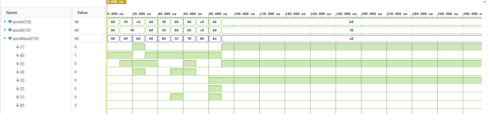

# posit-multiplier-vhdl

An **8-bit Posit multiplier (`es = 1`)** written in VHDL-2008, exhaustively verified against an independent Python reference model using GHDL, and synthesized, placed and routed in AMD Vivado 2026.1 for a Xilinx Virtex-7 FPGA.

The implementation includes Posit decoding, sign and exponent processing, mantissa multiplication, normalization, packing and rounding. All 65,536 possible input pairs have been verified with no mismatches.

**Author:** [Matheus Viganó Schirrmann](https://github.com/Dryiwnl)  
**Institution:** Universidade Federal de Santa Catarina (UFSC) — ProtoFPGA

## Architecture

The complete multiplier consists of a combinational datapath:

```text
          positA                         positB
             |                              |
             v                              v
       +-----------+                  +-----------+
       | Decoder A |                  | Decoder B |
       +-----+-----+                  +-----+-----+
             |                              |
             +---------------+--------------+
                             |
                 +-----------+-----------+
                 |                       |
                 v                       v
       +-------------------+   +-------------------+
       | Sign and Exponent |   |     Mantissa      |
       |  Processing Unit  |   |    Multiplier     |
       +---------+---------+   +---------+---------+
                 |                       |
                 |                       v
                 |             +-------------------+
                 |             |   Normalization   |
                 |             +---------+---------+
                 |                       |
                 +-----------+-----------+
                             |
                             v
                 +-----------------------+
                 |  Posit Component      |
                 |       Packing         |
                 +-----------+-----------+
                             |
                             v
                 +-----------------------+
                 |    Posit Rounding     |
                 |   and Sign Handling   |
                 +-----------+-----------+
                             |
                             v
                 +-----------------------+
                 |  Zero / NaR Handling  |
                 +-----------+-----------+
                             |
                             v
                        positResult
```

The hardware is divided into seven VHDL modules:

| Module | Description |
|---|---|
| `decoder_posit.vhd` | Extracts the sign, regime, exponent and fraction |
| `sign_and_exponent_PU.vhd` | Computes the sign, regime and exponent of the product |
| `mantissa_multiplier.vhd` | Multiplies the input significands |
| `normalization.vhd` | Normalizes the product and adjusts its scale |
| `posit_component_packing.vhd` | Reconstructs the Posit representation and handles saturation |
| `posit_rounding.vhd` | Implements round-to-nearest, ties-to-even and sign application |
| `posit_multiplier_top.vhd` | Integrates the modules and handles zero and NaR |

The RTL and post-synthesis schematics generated by Vivado are available in:

- [RTL architecture](docs/figures/rtl_architecture.pdf)
- [Post-synthesis schematic](docs/figures/post_synthesis_schematic.pdf)

## How Posit multiplication works

### Posit representation

Unlike IEEE-754 floating-point numbers, Posit numbers use a variable-length regime field in addition to the sign, exponent and fraction.

A nonzero, non-NaR Posit number is represented by:

```text
x = (-1)^s * useed^k * 2^e * (1+f)
```

where:

- `s` is the sign bit;
- `k` is the regime value;
- `e` is the exponent;
- `f` is the fractional part of the significand.

The value of `useed` depends on the exponent-size parameter:

```text
useed = 2^(2^es)
```

For Posit(8,1), `es = 1`, so:

```text
useed = 4

x = (-1)^s * 4^k * 2^e * (1+f)
```

The variable-length regime allows Posit numbers to represent a wide dynamic range while concentrating precision around values close to one.

### Multiplication

Given two Posit operands:

```text
x_a = (-1)^s_a * 4^k_a * 2^e_a * (1+f_a)

x_b = (-1)^s_b * 4^k_b * 2^e_b * (1+f_b)
```

Their product is:

```text
x_y = x_a * x_b

    = (-1)^(s_a+s_b)
      * 4^(k_a+k_b)
      * 2^(e_a+e_b)
      * (1+f_a)(1+f_b)
```

The multiplication is divided into three operations: sign processing, scale computation and significand multiplication.

**Sign**

The sign of the product is determined by XOR:

```text
s_y = s_a xor s_b
```

Equal signs produce a positive result, while different signs produce a negative result.

**Scale**

The regime and exponent determine the scale of each operand.

For Posit(8,1), the intermediate regime and exponent, before normalization, are:

```text
k_raw = k_a + k_b + floor((e_a + e_b)/2)

e_raw = (e_a + e_b) mod 2
```

Normalization can introduce an additional exponent carry, which may propagate into the regime.

**Mantissa multiplication**

The significands contain an implicit leading one:

```text
M_a = 1 + f_a

M_b = 1 + f_b
```

The product is:

```text
M_y = M_a * M_b
```

The implementation uses two 5-bit significands, generating a 10-bit intermediate product.

Since:

```text
1 <= M_a < 2
1 <= M_b < 2

1 <= M_y < 4
```

the product may require normalization.

If the significand product is greater than or equal to two, it is shifted right and the scale is incremented.

The normalized result is then passed to the packing and rounding stages.

### Packing and rounding

The packing module reconstructs the Posit bit pattern using the calculated regime, exponent and normalized fraction.

Because the regime has variable length, the number of available fraction bits depends on the magnitude of the result.

The rounding stage implements **round-to-nearest, ties-to-even**, using information from discarded bits to determine whether the encoded magnitude must be incremented.

Rounding occurs before the sign is applied to the encoded result.

The implementation also handles saturation at the representable extremes.

### Special values

Posit(8,1) has two special bit patterns:

| Value | Binary encoding | Hexadecimal |
|---|---|---|
| Zero | `00000000` | `0x00` |
| NaR (Not a Real) | `10000000` | `0x80` |

The top-level module applies the following rules:

```text
NaR * x  = NaR

0 * x    = 0, if x is not NaR
```

NaR has priority over zero.

Unlike logarithmic Takum multiplication, Posit multiplication requires a significand multiplier in addition to sign and scale processing.

## Vivado simulation

The multiplier was simulated in Vivado using representative 8-bit operand combinations.

The waveform shows both input operands and the resulting Posit product, displayed in hexadecimal alongside the individual result bits.



[Open the waveform image](docs/figures/waveform.png)

The waveform was generated using the integrated VHDL multiplier testbench.

## Repository layout

```text
rtl/                         VHDL arithmetic hardware
├── decoder_posit.vhd
├── sign_and_exponent_PU.vhd
├── mantissa_multiplier.vhd
├── normalization.vhd
├── posit_component_packing.vhd
├── posit_rounding.vhd
└── posit_multiplier_top.vhd

verification/                Functional verification
├── posit_reference.py       Independent Python reference model
├── results.txt              Exhaustive verification results
└── tb/                      VHDL testbenches
    ├── tb_decoder_posit.vhd
    ├── tb_sign_and_exponent_PU.vhd
    ├── tb_mantissa_multiplier.vhd
    ├── tb_normalization.vhd
    ├── tb_posit_component_packing.vhd
    ├── tb_posit_rounding.vhd
    ├── tb_posit_multiplier_top.vhd
    └── tb_posit_exhaustive.vhd

vivado/                      FPGA synthesis and implementation
└── synth/
    ├── build.tcl            Automated Vivado implementation script
    ├── posit_mul_synth_wrapper.vhd
    ├── README.md
    └── reports/
        ├── utilization.rpt
        ├── utilization_hier.rpt
        ├── timing.rpt
        ├── paths.rpt
        └── power.rpt

docs/                        Technical diagrams
└── figures/
    ├── rtl_architecture.pdf
    ├── post_synthesis_schematic.pdf
    └── waveform.png

README.md
```

## Quick start

### Requirements

The verification environment uses:

- Python 3.12.6
- GHDL 6.0.0
- VHDL-2008

AMD Vivado 2026.1 is required to reproduce the FPGA implementation.

### Reference model

The independent Python model calculates the expected multiplication results for all 8-bit Posit operand pairs.

From the repository root:

```bash
python verification/posit_reference.py
```

The reference vectors are used by the exhaustive VHDL testbench.

### GHDL verification

Compile the VHDL modules in dependency order:

```bash
ghdl -a --std=08 rtl/decoder_posit.vhd
ghdl -a --std=08 rtl/sign_and_exponent_PU.vhd
ghdl -a --std=08 rtl/mantissa_multiplier.vhd
ghdl -a --std=08 rtl/normalization.vhd
ghdl -a --std=08 rtl/posit_component_packing.vhd
ghdl -a --std=08 rtl/posit_rounding.vhd
ghdl -a --std=08 rtl/posit_multiplier_top.vhd
```

Compile and elaborate the exhaustive testbench:

```bash
ghdl -a --std=08 verification/tb/tb_posit_exhaustive.vhd
ghdl -e --std=08 tb_posit_exhaustive
```

Run it with the reference-vector file in the location expected by the testbench:

```bash
ghdl -r --std=08 tb_posit_exhaustive
```

The testbench compares the multiplier output against the Python reference for every operand pair.

## Verification

The reference model is independent of the VHDL implementation.

It determines the expected result for each operand pair according to the Posit(8,1) representation and rounding rules.

For two 8-bit operands:

```text
Number of values per operand = 2^8 = 256

Total operand pairs = 256 * 256 = 65,536
```

Every possible operand pair was tested.

| Test | Inputs | Width | Result |
|---|---:|---|---|
| Complete multiplier, exhaustive | 65,536 pairs | 8 bits | No mismatches |
| Positive and negative operands | Included | 8 bits | Passed |
| Zero and NaR | Included | 8 bits | Passed |
| Extreme representable values | Included | 8 bits | Passed |
| Rounding cases | Included | 8 bits | Passed |
| Vivado waveform demonstration | 10 cases | 8 bits | Simulated |

### Exhaustive results

| Metric | Result |
|---|---:|
| Total operand pairs | **65,536** |
| Correct results | **65,536** |
| Mismatches | **0** |
| Operand-pair coverage | **100%** |

```text
TOTAL   = 65536
CORRECT = 65536
ERRORS  = 0
```

The exhaustive test produced no mismatches.

[Full verification results](verification/results.txt)

## Synthesis and implementation

The complete Posit(8,1) multiplier was synthesized, placed and routed using AMD Vivado 2026.1.

A registered wrapper was added around the combinational arithmetic circuit to measure input-to-output timing with a defined clock constraint.

### Implementation configuration

| Parameter | Configuration |
|---|---|
| FPGA family | Xilinx Virtex-7 |
| Device | `xc7vx485tffg1157-1` |
| Vivado version | 2026.1 |
| Arithmetic format | Posit(8,1) |
| Synthesis | Out-of-context |
| Implementation | Placement and routing |
| Clock constraint | 10 ns |
| Measurement | Registered input/output wrapper |
| Internal pipelining | None |

### Resource utilization

Post-implementation resource utilization:

| Resource | Used |
|---|---:|
| Slice LUTs | **986** |
| CARRY4 | **163** |
| DSP blocks | **0** |
| Flip-flops | **36** |
| Block RAM | **0** |
| Slices | **281** |

The 36 flip-flops belong to the measurement wrapper, not to the combinational multiplier core.

The implementation uses LUTs and carry-chain resources for arithmetic, without dedicated DSP blocks.

Reports:

- [Resource utilization](vivado/synth/reports/utilization.rpt)
- [Hierarchical utilization](vivado/synth/reports/utilization_hier.rpt)

### Timing analysis

The implementation used a 10 ns clock constraint, corresponding to a target frequency of 100 MHz.

| Metric | Result |
|---|---:|
| Clock constraint | 10.000 ns |
| Worst Negative Slack (WNS) | **−3.544 ns** |
| Estimated minimum period | **13.544 ns** |
| Estimated Fmax | **73.8 MHz** |
| Worst data-path delay | 13.510 ns |
| Critical-path logic levels | 28 |

The minimum period is estimated using:

```text
T_min = T_constraint - WNS

T_min = 10 - (-3.544)

T_min = 13.544 ns
```

The estimated maximum frequency is:

```text
Fmax = 1000 / T_min

Fmax = 1000 / 13.544

Fmax = 73.8 MHz
```

The implementation **does not meet the original 100 MHz timing constraint**.

The worst data path contains:

| Component | Delay |
|---|---:|
| Logic | 3.189 ns |
| Routing | 10.321 ns |
| Total | 13.510 ns |

Approximately 76% of the reported data-path delay comes from routing.

The estimated Fmax refers to the full registered measurement path and depends on the FPGA, timing constraints and routing.

Reports:

- [Timing summary](vivado/synth/reports/timing.rpt)
- [Critical paths](vivado/synth/reports/paths.rpt)

### Power estimation

Vivado reported the following power estimates:

| Component | Estimated power |
|---|---:|
| Dynamic power | **24 mW** |
| Device static power | **241 mW** |
| Total on-chip power | **265 mW** |
| Confidence level | Medium |

The dynamic-power estimate includes the measurement implementation.

Power was estimated using Vivado vectorless activity propagation without an externally supplied switching-activity file.

These values are estimates, not physical FPGA measurements.

[Full power report](vivado/synth/reports/power.rpt)

### Reproducing synthesis

The automated synthesis and implementation files are available in [`vivado/synth/`](vivado/synth/).

```text
build.tcl
posit_mul_synth_wrapper.vhd
reports/
```

The Tcl script performs out-of-context synthesis, placement, routing and report generation.

It can be executed through Vivado's Tcl interface in the configured environment.

The resulting utilization, timing and power reports may vary with the Vivado version, device, constraints and implementation settings.

## Status and next steps

The Posit(8,1) multiplier is functionally verified and implemented on the selected Virtex-7 target.

**Completed:**

- VHDL implementation of all seven modules.
- Posit decoding and special-value handling.
- Sign and exponent processing.
- Mantissa multiplication and normalization.
- Packing and round-to-nearest, ties-to-even.
- Individual module testbenches.
- Integrated multiplier testbench.
- Independent Python reference model.
- Exhaustive verification of 65,536 operand pairs.
- Vivado waveform simulation.
- FPGA synthesis, placement and routing.
- Resource utilization analysis.
- Post-route timing analysis.
- Power estimation.

**Next steps:**

- Optimize LUT utilization and critical-path delay.
- Investigate routing and arithmetic bottlenecks.
- Compare Posit, IEEE-754 and Takum implementations under consistent experimental conditions.
- Extend the multiplier to other Posit configurations.
- Complete the Portuguese technical documentation.

## Documentation

- [RTL architecture](docs/figures/rtl_architecture.pdf) — Vivado RTL schematic.
- [Post-synthesis schematic](docs/figures/post_synthesis_schematic.pdf) — hardware after synthesis and optimization.
- [Vivado waveform](docs/figures/waveform.png) — functional simulation.
- [Verification results](verification/results.txt) — exhaustive verification log.
- [Vivado implementation reports](vivado/synth/reports/) — utilization, timing, critical paths and power.

## References

1. GUSTAFSON, John L.; YONEMOTO, Isaac T. *Beating Floating Point at Its Own Game: Posit Arithmetic*. Supercomputing Frontiers and Innovations, 2017.

2. ZHANG, Hao; KO, Seok-Bum. *Efficient Multiple-Precision Posit Multiplier*. IEEE International Symposium on Circuits and Systems (ISCAS), 2021.

## Author

**Matheus Viganó Schirrmann**  
Computer Engineering — Universidade Federal de Santa Catarina (UFSC)  
ProtoFPGA — Araranguá, Santa Catarina, Brazil

2026
